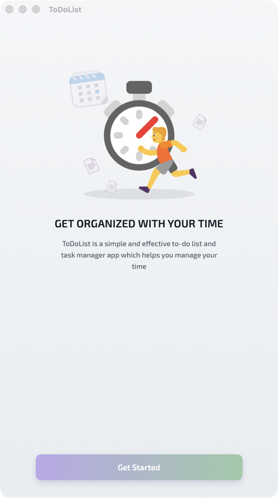
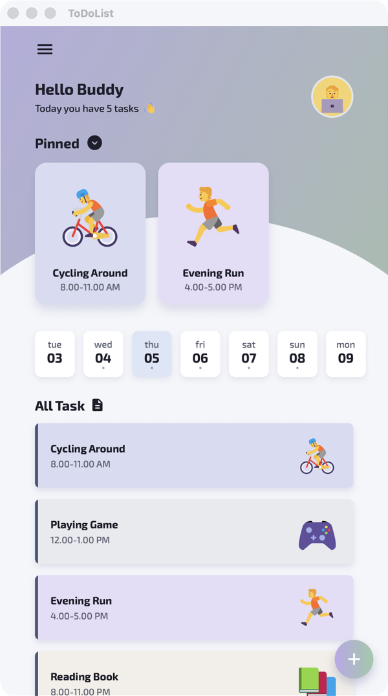
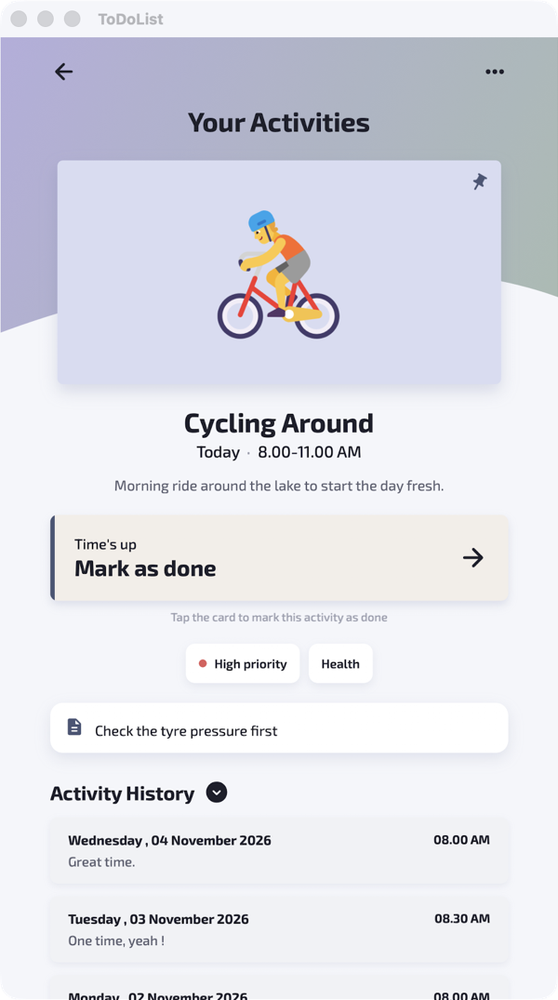
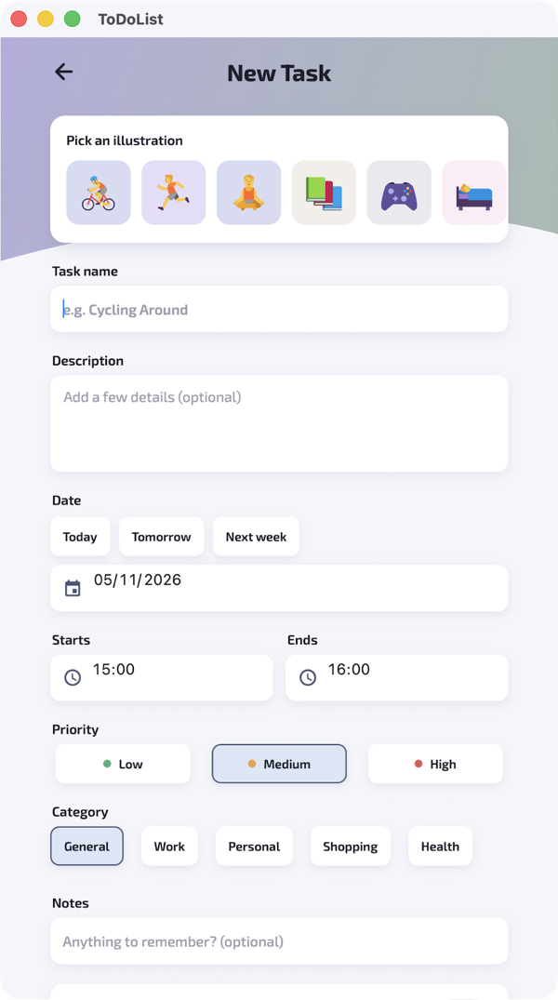
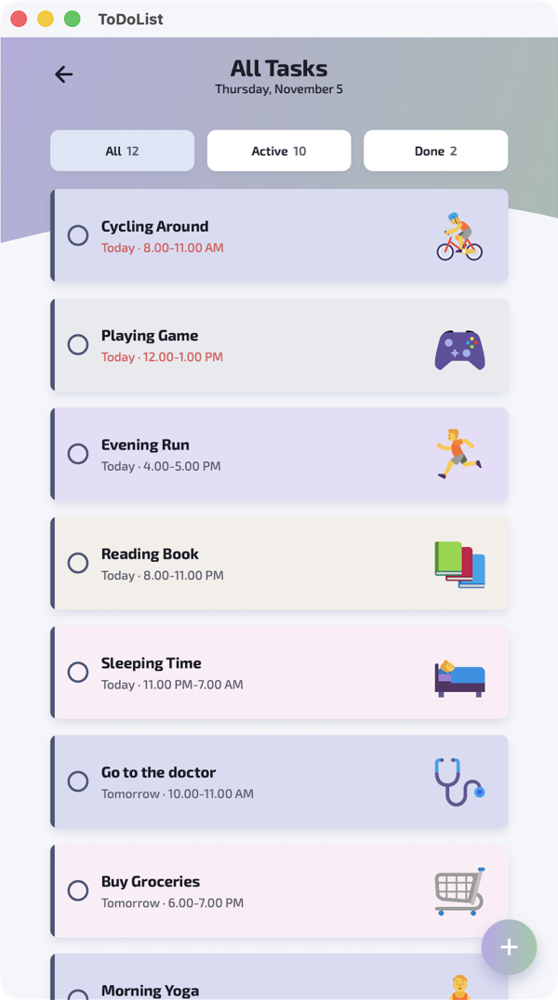

# ToDoList

A to-do list app built with **.NET MAUI** (.NET 10) using the MVVM pattern, with a soft pastel design (lavender/sage gradients, neumorphic cards, flat illustrations).

## Screenshots

| Welcome | Home | Your Activities |
|:---:|:---:|:---:|
|  |  |  |

| New Task | All Tasks |
|:---:|:---:|
|  |  |

## Features

- **Welcome screen** – illustration + "Get Started" (shown on first launch only)
- **Home** – greeting with avatar, **Pinned** tasks carousel, two-week date strip, the selected day's tasks with illustrations, floating **+** button, menu (all tasks, new task, change your name)
- **Your Activities (details)** – big illustration, live **"Starting in 00 : 05 : 05"** countdown (tap to mark done), priority/category, notes and **Activity History**; ••• menu to edit, pin, complete or delete
- **New / Edit task** – illustration picker, name (inline validation), description, date (quick Today / Tomorrow / Next week), start & end time, priority, category, notes, pin to home
- **All tasks** – All / Active / Done filter, tap the circle to complete

> Tasks are stored in memory (`MockItemStore`) with sample tasks, so changes are lost when the app closes.

## Credits (free / open-source assets)

| Asset | Source | License |
|---|---|---|
| Illustrations (`Resources/Images/fe_*.svg`) | [Fluent Emoji](https://github.com/microsoft/fluentui-emoji) by Microsoft | MIT |
| Font: Exo 2 | [Google Fonts](https://fonts.google.com/specimen/Exo+2) | SIL Open Font License 1.1 |
| Icons: Material Icons Round | [Google Material Design Icons](https://github.com/google/material-design-icons) | Apache 2.0 |

## Tech stack

| | |
|---|---|
| Framework | .NET MAUI 10.0.120 (.NET 10) |
| MVVM | [CommunityToolkit.Mvvm](https://github.com/CommunityToolkit/dotnet) 8.4.2 |
| Navigation | Shell with registered routes |
| DI | Built-in `MauiProgram` service registration |
| Platforms | iOS, Android, Mac Catalyst, Windows |

## Project structure

```
ToDoList/
├── Models/           TodoItem, ActivityEntry, ChipOption, DayOption
├── Services/         IitemStore<T> + MockItemStore (in-memory data)
├── ViewModels/       BaseViewModel, MainPage, ToDoItem, ToDoDetail, NewToDo
├── Views/            OnboardingPage, ToDoItemPage, ToDoDetailPage, NewToDoPage
├── Resources/Styles/ Colors.xaml, Styles.xaml (app theme)
├── MainPage.xaml     Home page
├── AppShell.xaml     Shell + route registration
└── MauiProgram.cs    Services, view models and pages registration
```

## Getting started

### Requirements

- .NET 10 SDK with the MAUI workload: `dotnet workload install maui`
- **macOS:** Xcode (for iOS / Mac Catalyst)
- **Android:** Android SDK + an emulator (Android Studio)

### Run

```bash
# Mac (Mac Catalyst)
dotnet build -t:Build;Run -f net10.0-maccatalyst ToDoList.csproj

# iOS Simulator
dotnet build -t:Build;Run -f net10.0-ios ToDoList.csproj

# Android Emulator
dotnet build -t:Build;Run -f net10.0-android ToDoList.csproj
```

Use `-t:Build;Run`, not just `-t:Run`: with .NET 10, `-t:Run` launches the app without building it first.

**VS Code:** add a task in `.vscode/tasks.json` that runs one of the commands above, then attach with a `coreclr` launch configuration. The `.vscode` folder is git-ignored, so it isn't part of this repo.

## Troubleshooting

**"This version of .NET for iOS requires Xcode X.Y"**
Your Xcode is newer than the .NET iOS SDK expects. `ToDoList.csproj` sets `<ValidateXcodeVersion>false</ValidateXcodeVersion>` to skip this check. To fix it properly, update the workloads (`sudo dotnet workload update`) or install the matching Xcode version.

**App opens and closes immediately**
Usually a XAML error at startup, for example:
- a `{StaticResource Name}` that isn't defined in `Colors.xaml` / `Styles.xaml`
- a Brush (e.g. `WhiteBrush`) assigned to a Color property like `TextColor`; use the Color (`White`) instead

## Author

[Venki-Sub](https://github.com/Venki-Sub)
